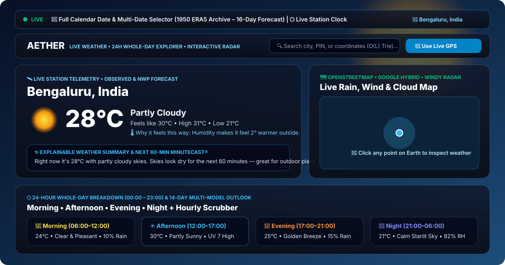
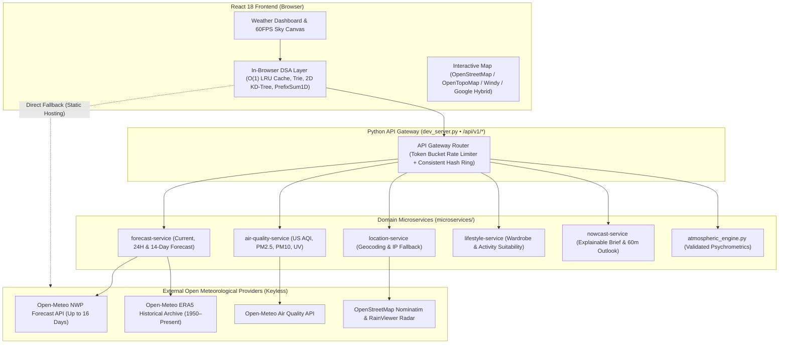

# 🌤️ AETHER — Full-Stack Weather Dashboard with Python Microservices

<div align="center">

### 🌍 **[👉 LAUNCH LIVE PUBLIC DEMO (https://drkanurag.github.io/Weather-app/) 👈](https://drkanurag.github.io/Weather-app/)**

[](https://drkanurag.github.io/Weather-app/)
[](https://raw.githack.com/drkanurag/Weather-app/main/index.html)
[](./tests/test_aether_suite.py)
[](./LICENSE)

<br />



</div>

---

## 📖 Overview

**AETHER** is a full-stack weather intelligence dashboard combining a responsive **React 18** frontend with a **Python 3** microservices gateway and psychrometric calculation engine. It provides live local weather, a 24-hour (`00:00`–`23:00`) whole-day explorer across selectable dates, a 14-day forecast, multi-layer interactive radar maps (**OpenStreetMap**, **OpenTopoMap**, **Windy.com**, and **Google Maps**), air-quality guidance, and plain-English daily recommendations.

The frontend is engineered to operate in two modes:
1. **Standalone Static Mode (GitHub Pages / CDN)**: Connects directly to keyless public meteorological endpoints (Open-Meteo NWP, ECMWF ERA5 Archive, Nominatim, RainViewer) with in-browser $O(1)$ LRU caching and client-side psychrometric calculations.
2. **Full-Stack Python Microservices Mode (`dev_server.py`)**: Routes requests through an API Gateway (`/api/v1/*`) backed by 6 domain services, per-service TTL caches, token-bucket rate limiting, and circuit-breaker fault isolation.

---

## 🔗 Public Live Demo Links

| Environment | Public URL | Notes |
| :--- | :--- | :--- |
| **🌍 Primary Live Demo (GitHub Pages)** | **[https://drkanurag.github.io/Weather-app/](https://drkanurag.github.io/Weather-app/)** | Always-on public deployment (works on desktop, tablet, and mobile) |
| **⚡ Global CDN Mirror (GitHack)** | **[https://raw.githack.com/drkanurag/Weather-app/main/index.html](https://raw.githack.com/drkanurag/Weather-app/main/index.html)** | Instant Cloudflare CDN mirror served from `main` |

---

## 🏗️ System Architecture



---

## 🔬 Data Provenance: Observed vs. Forecast vs. Estimated Values

AETHER clearly distinguishes between reanalysis observations, numerical weather prediction (NWP) forecasts, and derived empirical estimates:

| Data Category | Source / Algorithm | Supported Range & Limitations |
| :--- | :--- | :--- |
| **Current & 14-Day Forecast** | Open-Meteo Multi-Model NWP (`api.open-meteo.com`) | Live current telemetry and hourly/daily forecast up to **16 days ahead** (`14 days` displayed in the main outlook). Requests beyond +16 days return a clear validation error (`HTTP 400`). |
| **Historical Weather (1950–Present)** | ECMWF ERA5 Historical Reanalysis (`archive-api.open-meteo.com`) | Genuine historical hourly reanalysis starting from **`1950-01-01`**. Dates prior to `1950-01-01` are rejected with an explicit boundary message. |
| **Dew Point & Wet-Bulb ($T_w$)** | Magnus-Tetens & Roland Stull (2011) empirical formula ([`atmospheric_engine.py`](./atmospheric_engine.py)) | Validated over $-20^\circ\text{C} \le T \le 50^\circ\text{C}$ and $5\% \le \text{RH} \le 99\%$ with physical clamping ($T_d \le T_w \le T$). |
| **Wet-Bulb Globe Temperature (WBGT)** | **Empirical Estimate** (`wbgtIsEstimate: true` in [`atmospheric_engine.py`](./atmospheric_engine.py)) | **Important Scientific Disclaimer**: True WBGT requires a physical 150 mm black-globe thermometer. AETHER computes an *estimate* from ambient temperature, wet-bulb temperature, solar radiation, and wind speed. It is labeled as an estimate and must **not** be used as the sole basis for safety-critical occupational or athletic heat-stress decisions. |
| **Explainable Weather Summary** | Deterministic template synthesis ([`nowcast_service.py`](./microservices/nowcast_service.py)) | Synthesizes plain-English summaries strictly from actual forecast temperature, humidity, wind, and precipitation probability without hallucinating conditions. |

---

## ⚡ Data Structures & System Design Highlights

- **$O(1)$ Doubly-Linked List + Hash Map LRU Cache** ([`src/services/dsaEngine.js`](./src/services/dsaEngine.js), [`microservices/registry_service.py`](./microservices/registry_service.py)): Sub-millisecond cache lookups with automatic TTL expiry and least-recently-used eviction.
- **$O(L)$ Prefix Trie & $O(\log N)$ 2D Spatial KD-Tree** ([`src/services/dsaEngine.js`](./src/services/dsaEngine.js)): Instant city autocomplete and nearest-station Haversine spatial lookup.
- **$O(1)$ 1D Prefix Sum Array (`PrefixSum1D`) & Sliding Window**: Constant-time range averages across Morning, Afternoon, Evening, and Night dayparts, plus optimal 3-hour outdoor window detection.
- **Circuit Breaker & Fault Isolation** ([`microservices/registry_service.py`](./microservices/registry_service.py)): Each service wraps upstream HTTP calls in a `CLOSED -> OPEN -> HALF_OPEN -> CLOSED` state machine so a failing upstream provider degrades gracefully to a fallback without crashing the dashboard.

---

## 📡 Backend API Documentation

All backend endpoints return a standardized JSON envelope with distributed tracing headers (`X-Correlation-ID`, `X-Consistent-Hash-Shard`, `X-RateLimit-Remaining`):

```json
{
  "meta": {
    "service": "forecast-service",
    "correlationId": "cid-8f92a1b4c0",
    "timestamp": "2026-10-12T09:00:00Z",
    "status": "OK",
    "latencyMs": 1.42
  },
  "data": { ... }
}
```

| Endpoint | Method | Query Parameters | Description |
| :--- | :--- | :--- | :--- |
| `/api/v1/gateway/status` | `GET` | — | Health, cache hit/miss metrics, and circuit breaker states across all 6 services |
| `/api/v1/gateway/weather-bundle` | `GET` | `lat`, `lon`, `tz` | Parallel scatter-gather BFF bundle combining forecast, air quality, and lifestyle data |
| `/api/v1/location/search` | `GET` | `q` | Global city autocomplete search |
| `/api/v1/location/reverse` | `GET` | `lat`, `lon` | Reverse geocoding to nearest city/station |
| `/api/v1/forecast/current` | `GET` | `lat`, `lon`, `tz` | Current weather, 24-hour hourly array, and 14-day forecast |
| `/api/v1/forecast/date` | `GET` | `lat`, `lon`, `date`, `tz` | Full 24-hour weather for a specific date (`1950-01-01` to `+16 days`; returns `400` outside bounds) |
| `/api/v1/air-quality/current` | `GET` | `lat`, `lon` | US AQI, PM2.5, PM10, Ozone, NO₂, SO₂, CO |
| `/api/v1/lifestyle/recommendations` | `GET` | `temp`, `rain_prob`, `wind`, `uv`, `humidity` | Plain-English umbrella, clothing, sun protection, and outdoor guidance |
| `/api/v1/nowcast/brief` | `GET` | `city`, `temp`, `feels`, `high`, `low`, `rain_prob`, `cond` | Explainable daily brief, "Feels Like" reason, and 60-minute outlook slots |
| `/api/atmospheric-physics` | `GET` | `temp`, `humidity`, `pressure`, `wind`, `solar`, `elevation` | Validated psychrometric calculations (Dew Point, Stull Wet-Bulb, VPD, LCL, Air Density, and estimated WBGT) |

---

## 🚀 Local Development Setup

### Prerequisites
- **Python**: `3.9+` (uses standard library only; zero external pip packages required to run the server)
- **Node.js** *(Optional)*: `18+` if running via Create React App (`npm start`)

### 1. Clone the Repository
```bash
git clone https://github.com/drkanurag/Weather-app.git
cd Weather-app
```

### 2. Environment Configuration (Optional)
All meteorological providers used by AETHER (Open-Meteo, Nominatim, RainViewer) are keyless open APIs—no secret API keys are required. To customize local gateway port or rate-limit settings, copy `.env.example`:
```bash
cp .env.example .env
```

### 3. Start the Application (Python Gateway + Frontend)
```bash
python dev_server.py
```
Then open `http://localhost:3000` in your browser.

---

## 🧪 Automated Testing & CI

AETHER includes an automated test suite ([`tests/test_aether_suite.py`](./tests/test_aether_suite.py)) that runs automatically on every push via GitHub Actions ([`.github/workflows/ci.yml`](./.github/workflows/ci.yml)). It verifies:
- Input validation and physical invariants in [`atmospheric_engine.py`](./atmospheric_engine.py) (including WBGT estimation disclaimers)
- $O(1)$ LRU cache capacity eviction and TTL behavior
- Circuit breaker state transitions (`CLOSED -> OPEN -> HALF_OPEN -> CLOSED`) and graceful fallback isolation
- API Gateway routing, `X-Correlation-ID` propagation, and `HTTP 400` date-boundary validation
- Repository security scan ensuring zero hardcoded secret keys

Run the full test suite locally with:
```bash
python -m unittest discover -s tests -v
```

---

## ⚠️ Known Limitations

1. **Estimated WBGT**: Wet-Bulb Globe Temperature is approximated from standard meteorological variables rather than a physical black-globe sensor.
2. **Forecast Horizon**: Numerical weather prediction forecasts are limited to 16 days ahead; historical lookups (`1950-01-01` to present) use ERA5 reanalysis (~9–25 km grid resolution) rather than individual local thermometer station logs.
3. **In-Memory Caching**: Each Python microservice uses an isolated in-process `OrderedDict` TTL store; restarting `dev_server.py` clears the warm cache.

---

## 📄 License

Released under the [MIT License](./LICENSE).
